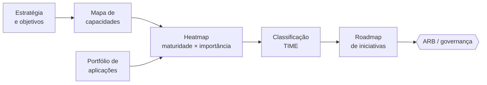

<h1 align="center">🧭 capability-map-template</h1>

  <strong>Modelo de mapa de capacidades de negócio, portfólio de aplicações (TIME) e roadmap — em Markdown, CSV e Mermaid, sem depender de ferramenta.</strong>

  
  
  
  

---

## 🎯 O problema

Sem um mapa de capacidades, o portfólio de aplicações vira uma lista de sistemas sem contexto: é difícil ver redundâncias, priorizar investimentos ou explicar ao C-Level **onde** a tecnologia sustenta (ou trava) o negócio.

## 💡 A solução

Um ponto de partida enxuto para **capability-based planning**:

1. **[Mapa de capacidades](capability-map.md)** — níveis L1/L2 para uma instituição de ensino (exemplo fictício e adaptável a outros setores).
2. **[Portfólio de aplicações](application-portfolio.csv)** — cada aplicação ligada às capacidades que suporta e classificada no modelo **TIME** (*Tolerate, Invest, Migrate, Eliminate*). O CSV pode ser importado em ferramentas de EA.
3. **[Roadmap](roadmap.md)** — iniciativas por trimestre, derivadas das lacunas do mapa.

## 🗺️ Do mapa à decisão

## 🔥 Heatmap (exemplo)

| Capacidade L1 | Importância | Maturidade | Leitura |
|---|---|---|---|
| Captação e matrícula | 🔴 Alta | 🟡 Média | Investir: impacto direto em receita |
| Experiência acadêmica | 🔴 Alta | 🟢 Alta | Sustentar |
| Relacionamento e atendimento | 🔴 Alta | 🔴 Baixa | **Prioridade 1** |
| Gestão financeira | 🟡 Média | 🟢 Alta | Sustentar |
| Dados e inteligência | 🔴 Alta | 🟡 Média | Investir |

## 🚀 Como usar

1. Ajuste as capacidades L1/L2 ao seu negócio (mantenha 6–10 L1).
2. Preencha o CSV com suas aplicações e as capacidades que cada uma suporta.
3. Pontue importância × maturidade com as áreas de negócio.
4. Derive o roadmap das capacidades críticas com baixa maturidade.

## 🔗 Relacionados

- [architecture-decision-records](https://github.com/ncontatori/architecture-decision-records) — registrar as decisões que saem do roadmap

---

Feito por <a href="https://ncontatori.github.io">Nestor Cremm Contatori</a> · <a href="https://linkedin.com/in/nestorcontatori">LinkedIn</a>

