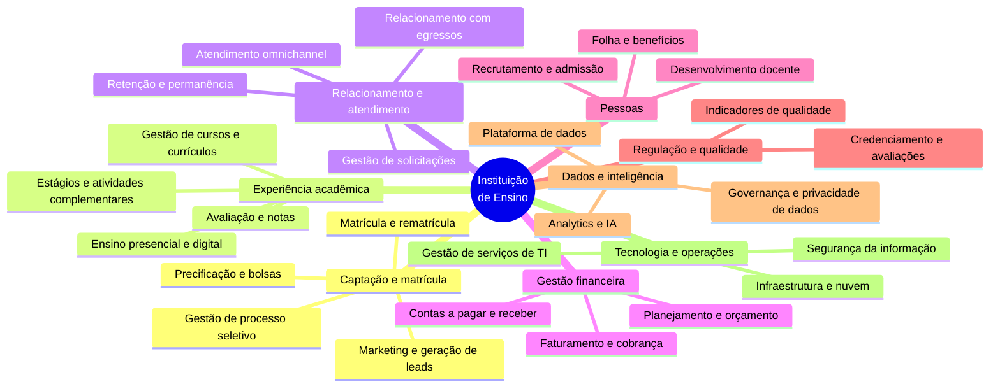

# Mapa de capacidades — Instituição de Ensino (exemplo fictício)

Capacidades descrevem **o que** o negócio faz, independentemente de **como** (processos) ou **com o quê** (sistemas). Por isso mudam pouco e servem de âncora para o portfólio e o roadmap.

## Tabela L1 → L2

| L1 | L2 | Dono de negócio |
|---|---|---|
| Captação e matrícula | Marketing e geração de leads · Processo seletivo · Matrícula e rematrícula · Precificação e bolsas | Diretoria Comercial |
| Experiência acadêmica | Cursos e currículos · Ensino presencial e digital · Avaliação · Estágios | Diretoria Acadêmica |
| Relacionamento e atendimento | Atendimento omnichannel · Solicitações · Retenção · Egressos | Diretoria de Experiência |
| Gestão financeira | Faturamento e cobrança · Contas a pagar/receber · Orçamento | Diretoria Financeira |
| Pessoas | Recrutamento · Folha e benefícios · Desenvolvimento docente | Diretoria de Pessoas |
| Regulação e qualidade | Credenciamento · Indicadores de qualidade | Diretoria Regulatória |
| Dados e inteligência | Plataforma de dados · Analytics e IA · Governança de dados | CDO / TI |
| Tecnologia e operações | ITSM · Segurança · Infraestrutura e nuvem | CTO / CIO |

## Boas práticas

- Nomeie capacidades com **substantivos** ("Gestão de cobrança"), não com sistemas ("SAP FI").
- Cada L2 deve ter **um** dono de negócio.
- Revise o mapa anualmente, junto do plano diretor de TI.
