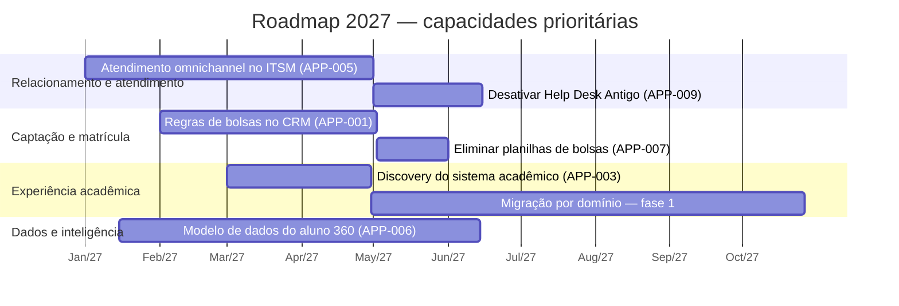

# Roadmap de capacidades (exemplo fictício)

Iniciativas derivadas do heatmap e da classificação TIME do [portfólio](application-portfolio.csv).

## Iniciativas

| Iniciativa | Capacidade | Aplicações | Resultado esperado | ADR |
|---|---|---|---|---|
| Atendimento omnichannel | Relacionamento e atendimento | APP-005, APP-009 | −1 sistema; visão única de solicitações | a criar |
| Regras de bolsas no CRM | Precificação e bolsas | APP-001, APP-007 | Fim das planilhas; trilha de auditoria | a criar |
| Modernização acadêmica | Gestão de cursos e avaliação | APP-003 | Redução de acoplamento e risco de obsolescência | a criar |
| Aluno 360 | Plataforma de dados | APP-006 | Indicadores de retenção confiáveis | a criar |

Cada iniciativa relevante deve gerar um ADR — veja [architecture-decision-records](https://github.com/ncontatori/architecture-decision-records).
